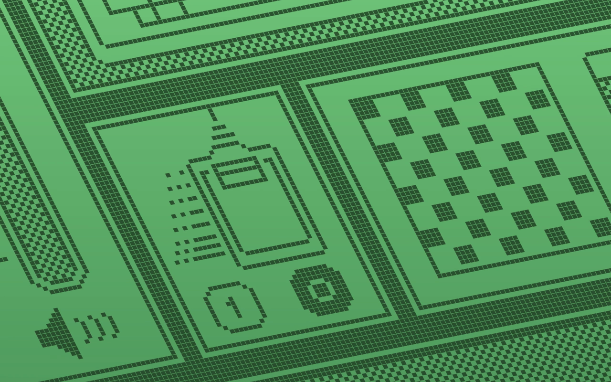

# Moher

Render 1-bit retro pixel-art scenes to video. Every black pixel is drawn as a rounded
dot over a cycling colour gradient and revealed by a directional sweep. A keyframed
orthographic camera pans across the tilted scene plane.



| Project | Scenes |
|---|---|
| `linux` | GRUB, kernel boot, systemd login, neofetch, i3 rice, htop, vim, pipes.sh, cmatrix, sl, cowsay, Compiz cube |
| `microsoft` | MS-DOS, Windows 3.1, Program Manager, Minesweeper, Solitaire, Paint, Windows 95, 3D Pipes, Clippy, Windows XP, Notepad, blue screen |
| `macintosh` | 12 classic Macintosh scenes |

## Requirements

Python 3.12+, [uv](https://docs.astral.sh/uv/) and ffmpeg. On NixOS, `shell.nix` provides
all three, plus the Vulkan loader for GPU rendering.

## Usage

```sh
uv run mac.py projects/linux                                   # -> projects/linux/out/linux.mp4
uv run mac.py projects/linux --width 1080 --height 1920 --fps 30
uv run mac.py projects/linux --still frame.png --at 12         # single frame
uv run mac.py projects/linux --gpu                             # wgpu (Vulkan/Metal/DX12)
uv run mac.py --gpucheck                                       # GPU output must match CPU
./render_chunks.sh projects/linux 8 --width 1920 --height 1080 --fps 60   # parallel CPU render
```

| Option | Default | |
|---|---|---|
| `--width`, `--height`, `--fps` | 2560, 1600, 60 | output format |
| `--zoom` | 1.0 | multiplies every scene's camera scale |
| `--opacity` | 0.85 | dot opacity |
| `--soft` | 0 | dot edge blur, in source pixels |
| `--saturation` | 1.0 | palette saturation |
| `--offset` | 0 | palette phase, 0–1 |
| `--start`, `--seconds` | 0, full loop | render a time range |
| `--encoder` | libx264 | e.g. `h264_nvenc`, `h264_vaapi` |

On NixOS, prefix commands with `nix-shell --run '…'`.

## Projects

A project is a directory containing:

- `images/image-N.png`: 1-bit frames (black = ink), stacked vertically for animation
- `animation.toml`: scenes, frame counts, durations, and keyframes for `camera_pos`,
  `camera_dir`, `scale`, `frame`, `progress` and `progress_angle`
- `color.png` (optional): palette with three columns (background top, background bottom, ink),
  where rows are time

`linux` and `microsoft` are generated from code. To regenerate them after editing:

```sh
cd projects/linux && uv run make_images.py
```

Generators use `retro.py`, which provides Unifont text, console screens, window chrome,
dithering and perspective warps. Each scene declares a `box`, the part of the image that
must fill the viewport. The camera zoom is fitted so the 16:9 frame never shows empty
margins. Text rendering needs `unifont.bdf`; set `UNIFONT=/path/to/unifont.bdf` if it
isn't found automatically.

## Credits

Renderer design and the `macintosh` scene timing are adapted from
[connorslade/macintosh-screensaver](https://github.com/connorslade/macintosh-screensaver).
All `linux` and `microsoft` artwork is original and procedurally drawn. Product names and
marks belong to their respective owners.

## License

MIT, see [LICENSE](LICENSE). Code only: the `macintosh` scene images are third-party and not covered.
